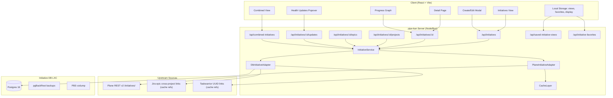

# spec.md — gbj-20261018-025 pipe-kan Initiatives plan

## Goal
Replace the modules-derived "Initiatives" fallback with real Plane initiatives (via `/api/v2/workspaces/{slug}/initiatives/`), add a dedicated Postgres database for sources that lack native initiatives (Taskwarrior; Jira cross-project epics), provision the database on its own Proxmox LXC via Ansible, integrate initiatives into the multi-source switcher with a combined view, and match Linear's initiatives UI exactly (tabs, tree, health, active-project dots, updates popover, progress graph, create modal, detail page). Retire modules-based initiatives explicitly; keep Plane modules visible under Projects or as "Modules".

## Non-goals
- Do NOT migrate historical Plane module data into initiatives. Modules remain as a separate concept.
- Do NOT implement real-time WebSocket push for initiative updates. Polling refresh only.
- Do NOT add AI-generated initiative descriptions or health predictions.
- Do NOT implement Atlassian Jira Premium Goals/Advanced Roadmaps read-through in P0/P1. Flagged as optional later adapter.
- Do NOT ship Terraform or Pulumi; provisioning is Ansible-only per repo conventions.
- Do NOT hardcode hostnames, IPs, VMIDs, or credentials in committed code or docs.

---

## 1. Current-state audit (verified against 0.35.0)

### 1.1 Initiatives are modules, not Plane initiatives

| Location | Finding |
|---|---|
| `src/plane.ts:819-840` | `buildParity()` builds `ParityInitiative[]` from `[...loaded.modules.values()]`. Each module becomes an initiative with key = `planeModuleKey(identifier, module.id)`, name = `module.name`, status derived from `module.status`. |
| `src/plane.ts:592-617` | `parseModule()` reads from `/workspaces/{slug}/projects/{id}/modules/`. |
| `src/plane.ts:663-710` | Catalog load walks each project, fetches modules, stores them in `cached.modules`. |
| `src/plane.ts:974-1063` | Module CRUD: `move` patches module status; `create` posts to `/modules/`; `edit` patches `/modules/{id}/`. |
| `src/parity.ts:175-189` | `ParityInitiative` type: `key`, `name`, `workspace`, `project`, `status`, `rawStatus`, `priority?`, `startDate?`, `targetDate?`, `updated?`, `health`, `activeProjects`. No `lead_id`, `state` enum, `description`, `label_ids`, `parent`, `project_ids`, `epic_ids`. |
| `src/app-api.ts:115-118` | `GET /api/parity` returns `app.parity()` which for Plane calls `cli.parity()` which is the modules-derived snapshot. |
| `src/app.ts:436-438` | `app.parity()` delegates to `cli.parity()` with fallback `{ initiatives: [], projects: [], workspaces: [] }`. |
| `src/App.tsx:2525` | Sidebar shows "Initiatives" nav row only when `processKind === "plane"`. |
| `src/App.tsx:3083-3087` | `RoadmapCanvas` renders initiatives from `parity.initiatives.filter(...)` with `matchViewFilter`. |
| `src/components/linear-chrome.tsx:553-600` | `InitiativeOverview` renders name, health, projects count (always "1/1" or "0/1"), active marks, target, progress graph, update composer. No description, lead, labels, child initiatives. |
| `src/components/linear-chrome.tsx:160-181` | `RoadmapTable` `kind: "initiatives" \| "projects"` prop; no true initiative hierarchy. |

### 1.2 No Plane `/initiatives/` endpoints are called

A grep of `src/` for `initiative` outside comments and UI strings finds only:
- `ParityInitiative` type and helpers in `src/parity.ts`
- UI components in `src/components/linear-chrome.tsx`, `src/components/linear-views.tsx`
- `openInitiatives` in `src/App.tsx`
- No `fetch` to `/initiatives/` in `src/plane.ts`, `src/app.ts`, or `src/server/`.

### 1.3 No initiatives for Jira or Taskwarrior

- `src/cli.ts:10-28` — `Cli` interface has `parity?()` but Jira and store CLIs do not implement it.
- `src/server.ts:44-46` — Taskwarrior source switch returns `"Taskwarrior is not connected"`.
- Jira mode (`src/App.tsx:2525`) hides the Initiatives nav row entirely.

### 1.4 Saved views, favorites, display options are localStorage-only

Keys (from `src/parity.ts:669-672`):
- `board-display-options` — `DisplayOptions` (layout, grouping, ordering, zoom, showEmptyGroups, completed, showSubIssues, properties)
- `board-view-filter` — `ViewFilter`
- `board-saved-views` — `SavedView[]`
- `linear-favorites` — `LinearFavorite[]`

No server-side persistence for views or favorites.

---

## 2. Target architecture

### 2.1 High-level diagram



### 2.2 Adapter pattern

The server layer uses an `InitiativeAdapter` interface with two implementations:

1. **PlaneInitiativeAdapter** — live reads from Plane REST v2 (and v1 fallback). Read-only for initiatives; write-through for edits/creates/links.
2. **DbInitiativeAdapter** — Postgres-backed CRUD for sources without native initiatives. Stores initiative definitions, cross-source links (references + cache), saved views, favorites, display layout.

Combined view queries both adapters, merges results, applies dedup/identity rules.

---

## 3. Data model

### 3.1 Plane native initiatives (external source of truth)

Plane API v2 fields (public docs, developers.plane.so):

| Field | Type | Notes |
|---|---|---|
| `id` | string | UUID |
| `name` | string | |
| `description` | string \| null | Plain text |
| `description_html` | string \| null | Rich text |
| `state` | enum | `DRAFT`, `PLANNED`, `ACTIVE`, `COMPLETED`, `CLOSED` |
| `lead_id` | string \| null | User UUID |
| `start_date` | ISO date \| null | |
| `end_date` | ISO date \| null | |
| `label_ids` | string[] | UUID refs |
| `project_ids` | string[] | Linked project UUIDs |
| `logo_props` | object \| null | |
| `archived_at` | ISO datetime \| null | |
| `created_at` | ISO datetime | |
| `updated_at` | ISO datetime | |

**Assumption A1:** Plane v2 initiatives expose `parent_id` for tree hierarchy. Public docs do not confirm this; if absent, tree is plan-gated to flat list. See spike ticket T-Spike-Plane-Initiative-Tree.

**Assumption A2:** Plane initiatives expose epic linking via `/initiatives/{id}/epics/` or `epic_ids` array. If absent, progress roll-up uses project-level aggregation only.

### 3.2 Postgres schema (local source of truth for non-Plane sources)

```sql
-- Extensions
CREATE EXTENSION IF NOT EXISTS "uuid-ossp";
CREATE EXTENSION IF NOT EXISTS "pg_trgm"; -- for fuzzy search on names

-- Initiatives table (DB-backed sources: taskwarrior, jira-cross-project)
CREATE TABLE initiatives (
    id UUID PRIMARY KEY DEFAULT uuid_generate_v4(),
    source_kind VARCHAR(32) NOT NULL CHECK (source_kind IN ('taskwarrior', 'jira')),
    source_workspace VARCHAR(128), -- e.g. jira project key or taskwarrior context
    name VARCHAR(512) NOT NULL,
    description TEXT,
    lead VARCHAR(256), -- free-text display name; no foreign key to users table
    state VARCHAR(32) NOT NULL DEFAULT 'DRAFT' CHECK (state IN ('DRAFT', 'PLANNED', 'ACTIVE', 'COMPLETED', 'CLOSED')),
    start_date DATE,
    end_date DATE,
    parent_id UUID REFERENCES initiatives(id) ON DELETE SET NULL,
    label_ids UUID[] DEFAULT '{}',
    created_at TIMESTAMPTZ NOT NULL DEFAULT now(),
    updated_at TIMESTAMPTZ NOT NULL DEFAULT now(),
    archived_at TIMESTAMPTZ,
    -- tree materialized path for fast queries
    path LTREE,
    CONSTRAINT no_self_parent CHECK (parent_id IS DISTINCT FROM id)
);

CREATE INDEX idx_initiatives_source ON initiatives(source_kind, source_workspace);
CREATE INDEX idx_initiatives_state ON initiatives(state) WHERE archived_at IS NULL;
CREATE INDEX idx_initiatives_parent ON initiatives(parent_id) WHERE parent_id IS NOT NULL;
CREATE INDEX idx_initiatives_path ON initiatives USING GIST(path);
CREATE INDEX idx_initiatives_name_trgm ON initiatives USING GIN(name gin_trgm_ops);

-- Labels table (local only; Plane labels are referenced by UUID externally)
CREATE TABLE initiative_labels (
    id UUID PRIMARY KEY DEFAULT uuid_generate_v4(),
    source_kind VARCHAR(32) NOT NULL,
    name VARCHAR(128) NOT NULL,
    color VARCHAR(7), -- hex
    UNIQUE(source_kind, name)
);

-- Cross-source links: reference external work items without copying them
CREATE TABLE initiative_links (
    id UUID PRIMARY KEY DEFAULT uuid_generate_v4(),
    initiative_id UUID NOT NULL REFERENCES initiatives(id) ON DELETE CASCADE,
    source_kind VARCHAR(32) NOT NULL CHECK (source_kind IN ('plane', 'jira', 'taskwarrior')),
    source_workspace VARCHAR(128),
    external_key VARCHAR(256) NOT NULL, -- issue key or task UUID
    external_title VARCHAR(512),
    external_status VARCHAR(128),
    external_progress INTEGER CHECK (external_progress BETWEEN 0 AND 100),
    fetched_at TIMESTAMPTZ,
    ttl_seconds INTEGER NOT NULL DEFAULT 300,
    created_at TIMESTAMPTZ NOT NULL DEFAULT now()
);

CREATE INDEX idx_links_initiative ON initiative_links(initiative_id);
CREATE INDEX idx_links_external ON initiative_links(source_kind, external_key);

-- Saved views (server-side persistence, replaces localStorage for initiative views)
CREATE TABLE initiative_views (
    id UUID PRIMARY KEY DEFAULT uuid_generate_v4(),
    user_id VARCHAR(128) NOT NULL, -- opaque; pipe-kan has no auth, use a stable identifier
    name VARCHAR(256) NOT NULL,
    scope VARCHAR(32) NOT NULL DEFAULT 'personal' CHECK (scope IN ('personal', 'workspace')),
    filter_json JSONB NOT NULL DEFAULT '{}',
    display_json JSONB NOT NULL DEFAULT '{}',
    sources VARCHAR(32)[] DEFAULT '{plane,jira,taskwarrior}',
    created_at TIMESTAMPTZ NOT NULL DEFAULT now(),
    updated_at TIMESTAMPTZ NOT NULL DEFAULT now()
);

CREATE INDEX idx_views_user ON initiative_views(user_id);

-- Favorites
CREATE TABLE initiative_favorites (
    id UUID PRIMARY KEY DEFAULT uuid_generate_v4(),
    user_id VARCHAR(128) NOT NULL,
    initiative_id UUID NOT NULL REFERENCES initiatives(id) ON DELETE CASCADE,
    folder VARCHAR(128),
    sort_order INTEGER NOT NULL DEFAULT 0,
    created_at TIMESTAMPTZ NOT NULL DEFAULT now(),
    UNIQUE(user_id, initiative_id)
);

CREATE INDEX idx_favorites_user ON initiative_favorites(user_id);

-- Display layout per user (mirrors localStorage board-display-options)
CREATE TABLE initiative_display (
    user_id VARCHAR(128) PRIMARY KEY,
    layout_json JSONB NOT NULL DEFAULT '{}',
    updated_at TIMESTAMPTZ NOT NULL DEFAULT now()
);

-- Schema migrations table (tool-managed)
CREATE TABLE schema_migrations (
    version VARCHAR(14) PRIMARY KEY,
    applied_at TIMESTAMPTZ NOT NULL DEFAULT now(),
    checksum VARCHAR(64) NOT NULL
);
```

**Data-minimisation:**
- `initiative_links` stores only reference metadata (key, title, status, progress, fetched_at). Work item bodies, comments, attachments are never copied.
- Plane/Jira native initiatives are read live and never stored as source of truth. If caching is added later, TTL is short (≤5 minutes) and cache rows are ephemeral.
- `user_id` is an opaque stable string (e.g. `local:` prefix + localStorage-generated UUID). No PII.

### 3.3 Client data model

```typescript
type InitiativeState = "DRAFT" | "PLANNED" | "ACTIVE" | "COMPLETED" | "CLOSED";

type InitiativeLead = {
  id: string;
  name: string;
  avatar?: string;
};

type InitiativeLabel = {
  id: string;
  name: string;
  color: string;
};

type InitiativeProjectRef = {
  id: string;
  identifier: string;
  name: string;
  status: string;
  health: Health;
};

type InitiativeUpdate = {
  id: string;
  health: Health;
  body: string;
  author: InitiativeLead;
  createdAt: string;
};

type Initiative = {
  id: string;
  source: SourceId; // "plane" | "jira" | "taskwarrior"
  name: string;
  description?: string;
  descriptionHtml?: string;
  state: InitiativeState;
  lead?: InitiativeLead;
  startDate?: string;
  endDate?: string;
  labels: InitiativeLabel[];
  projectIds: string[];
  projects?: InitiativeProjectRef[]; // hydrated
  parentId?: string;
  children?: Initiative[]; // hydrated tree
  updates: InitiativeUpdate[];
  createdAt: string;
  updatedAt: string;
  archivedAt?: string;
  // Computed / derived
  progress: number; // 0-100 rolled up from projects/epics/work items
  health: Health;
};
```

---

## 4. API surface (server routes)

All routes are added to `src/app-api.ts` alongside existing handlers.

### 4.1 Plane initiatives (native live)

| Method | Path | Auth | Description |
|---|---|---|---|
| GET | `/api/initiatives` | Plane API key | List initiatives with filters, pagination, expand |
| GET | `/api/initiatives/:id` | Plane API key | Detail with expand=lead,projects,epics |
| POST | `/api/initiatives` | Plane API key | Create initiative |
| PATCH | `/api/initiatives/:id` | Plane API key | Edit initiative |
| POST | `/api/initiatives/:id/projects` | Plane API key | Link project(s) |
| DELETE | `/api/initiatives/:id/projects/:projectId` | Plane API key | Unlink project |
| POST | `/api/initiatives/:id/epics` | Plane API key | Link epic(s) |
| DELETE | `/api/initiatives/:id/epics/:epicId` | Plane API key | Unlink epic |
| GET | `/api/initiatives/:id/updates` | Plane API key | List updates (if Plane exposes them; else local fallback) |
| POST | `/api/initiatives/:id/updates` | Plane API key | Post update (if Plane exposes them; else local fallback) |

**Graceful degradation:** If Plane returns HTTP 402 (feature not enabled), the adapter returns `enabled: false` and the UI shows a "Initiatives not enabled on this Plane workspace" state with a CTA to enable or switch to DB-backed mode.

### 4.2 DB-backed initiatives

| Method | Path | Auth | Description |
|---|---|---|---|
| GET | `/api/db/initiatives` | None (local) | List DB-backed initiatives |
| GET | `/api/db/initiatives/:id` | None | Detail |
| POST | `/api/db/initiatives` | None | Create |
| PATCH | `/api/db/initiatives/:id` | None | Edit |
| DELETE | `/api/db/initiatives/:id` | None | Archive/soft-delete |
| POST | `/api/db/initiatives/:id/links` | None | Link external work item |
| DELETE | `/api/db/initiatives/:id/links/:linkId` | None | Unlink |
| POST | `/api/db/initiatives/:id/updates` | None | Post update |
| GET | `/api/db/initiatives/:id/progress` | None | Computed roll-up from linked items |

### 4.3 Combined view

| Method | Path | Description |
|---|---|---|
| GET | `/api/combined-initiatives` | Merge Plane native + DB-backed + Jira cross-project. Accepts `?sources=plane,jira,taskwarrior` |

### 4.4 Saved views, favorites, display

| Method | Path | Description |
|---|---|---|
| GET | `/api/initiative-views` | Saved views for current user |
| POST | `/api/initiative-views` | Create view |
| PATCH | `/api/initiative-views/:id` | Update view |
| DELETE | `/api/initiative-views/:id` | Delete view |
| GET | `/api/initiative-favorites` | Favorites |
| POST | `/api/initiative-favorites` | Add favorite |
| DELETE | `/api/initiative-favorites/:id` | Remove favorite |
| GET | `/api/initiative-display` | Display layout |
| POST | `/api/initiative-display` | Save layout |

---

## 5. UI specification

### 5.1 Tab mapping: Linear → Plane states

Linear tabs map to Plane `state` as follows:

| Linear tab | Plane states | Assumption |
|---|---|---|
| Active | `ACTIVE` | A3: single-state mapping |
| Planned | `DRAFT`, `PLANNED` | A4: grouped under "Planned" |
| Completed | `COMPLETED`, `CLOSED` | A5: grouped under "Completed" |
| All | all | |

**A3-A5:** These groupings are assumptions because Plane docs show discrete states and do not prescribe tab semantics. Validate by calling the API and checking real workspace data.

### 5.2 Initiatives list page

Header:
- Pill tabs: "Initiatives | Active | Planned | Completed" (with status icons)
- "+ New initiative" button top-right
- "Filter" button left of toolbar row
- "Display" button right

Table columns (matching Linear exactly):
1. **Name** — icon + title + 2-line muted description. Expand caret for children (tree).
2. **Owner** — avatar circle (20px) or "—" fallback.
3. **Target** — date at quarter/half/year granularity (e.g. "May 2025", "Q2 2025", "H2 2026", "2026").
4. **Initiative Health** — green/yellow/red/gray pulse icon + label + age of last update (e.g. "On track · 13d").
5. **Projects** — hex-check icon + "completed / total" (e.g. "0 / 7").
6. **Active Projects** — colored dots with counts: green on track, yellow at risk, red off track, gray no update.
7. Optionally **Activity** — chevron-stack intensity icon, dash when none.

Tree: sub-initiatives render under parents with connector lines, nested to 3 levels. Each row carries its own owner/target/health/projects.

Row hover: shade wash. Row selected: accent border-left.

### 5.3 Health updates popover

Clicking the health cell opens a popover:
- Latest update: health + age, author, body
- Reactions/comment icons
- "Write update" button → opens composer inline
- Bell subscribe toggle
- Arrow-key navigation between initiative rows while popover is open

Update composer:
- Health dropdown: On track / At risk / Off track
- Body textarea
- Cancel / Post update buttons

### 5.4 Progress graph

Stacked area/streamgraph "Progress" over date range:
- X-axis: time (weeks/months depending on zoom)
- Y-axis: scope count
- Tooltip card on hover: initiative name, scope count, lead
- Data from rolled-up project/epic → work item counts

### 5.5 Create-initiative modal

Fields:
- Name (required)
- Description (rich text, initially plain textarea)
- State dropdown (default DRAFT)
- Lead picker (search users; if Plane API lacks user search, free-text)
- Target date range (start / end)
- Labels multi-select
- Parent initiative (optional, tree picker)
- Projects multi-select (link existing projects)

### 5.6 Initiative detail page

Overview tab:
- Description (rich text render)
- Properties sidebar: status badge, lead, target date, labels, projects list with status
- Updates section (list + composer)

Projects tab:
- Table of linked projects with health, progress, issue count
- "Add project" button

Children tab (if tree supported):
- Sub-initiative list with inline add

---

## 6. Phasing

### P0 — Core: Real Plane initiatives read, DB schema, basic UI parity

1. **T1** — Plane initiative adapter: v2 GET /initiatives/, v1 fallback, fields mapping, throttle (ADR-0017), workspace slug (ADR-0015/0016). Replace modules-derived `ParityInitiative` with real data in `/api/parity` and new `/api/initiatives`.
2. **T2** — Postgres schema migrations, pooled client, DSN from Vault-fed env. Offline degradation (return empty lists with warning toast).
3. **T3** — DB-backed initiative CRUD: `initiatives`, `initiative_links`, `initiative_labels` tables. Taskwarrior UUID linking, Jira epic cross-project linking.
4. **T4** — Retire modules-based initiatives: rename sidebar nav to "Modules" or move under Projects. Update `buildParity` to exclude modules from initiatives. Keep `ParityInitiative` type but populate from Plane adapter.
5. **T5** — Linear initiatives list UI: tabs, table columns (Name, Owner, Target, Health, Projects, Active Projects), tree rendering, source badges.

### P1 — Write, link, updates, progress

6. **T6** — Initiative create/edit modals (Plane native + DB-backed).
7. **T7** — Project/epic link/unlink with confirmation + optimistic update + rollback.
8. **T8** — Health updates popover + composer (local-only for DB-backed; Plane native if API supports it).
9. **T9** — Progress graph with rolled-up data (initiative → projects/epics → work items).
10. **T10** — Initiative detail page (overview, projects tab, children tab).

### P2 — Combined view, provisioning, ops

11. **T11** — Multi-source combined initiatives view: merge Plane native + DB-backed + Jira cross-project. Source badges, dedup rules, partial-failure handling, per-source caching, sorting/grouping/filter across sources.
12. **T12** — Saved views, favorites, display layout migrated to Postgres with fallback to localStorage.
13. **T13** — Proxmox LXC provisioning: Ansible role, inventory-driven, proposal script, check-mode diff, approval gate.
14. **T14** — Monitoring hook, backups, restore test, ops runbook.
15. **T15** — Fake-data smoke tests, ADR-0020, user docs.

---

## 7. Risks

| Risk | Impact | Mitigation |
|---|---|---|
| Plane v2 initiatives API returns 402 (not enabled) or 404 | High | Graceful "not enabled" UI; DB-backed fallback for operators who want initiatives without Plane feature |
| Plane `parent_id` or epic-link endpoints do not exist | High | Spike ticket T-Spike-Plane-Initiative-Tree before P0 commit; if missing, ship flat list + manual parent field |
| Postgres LXC provisioning blocked by inventory/Vault issues | Medium | Proposal script is read-only; approval gate prevents premature apply; local SQLite fallback is out of scope but Postgres can run in Docker for dev |
| Multi-source combined view performance degrades with many initiatives | Medium | Per-source caching (TTL 60s), pagination (limit 200), client-side virtualised list |
| Jira has no native initiatives; cross-project epic linking is brittle | Medium | Cache links with TTL; stale data is acceptable for roadmap view; explicit "refresh links" action |
| Taskwarrior tasks have no project/epic hierarchy for roll-up | Low | Progress roll-up for Taskwarrior initiatives is manual % entry or count of linked UUIDs |

---

## 8. Needs-Vishal

1. **Approval of proposed LXC resources** — 1 vCPU / 1 GiB RAM / 8 GiB disk / Debian 12 / Postgres 16. Is this sufficient for expected initiative volume (estimate: <10k initiatives, <100k links)?
2. **Vault path for Postgres DSN** — What KV path and AppRole should the pipe-kan server use? Is HashiCorp Vault already running in the homelab?
3. **Combined view default sources** — Should "All initiatives" default to Plane only, or auto-include DB-backed/Jira if those sources are active?
4. **Modules retirement path** — Keep "Modules" as a separate nav item under Projects, or remove entirely from sidebar and leave accessible only via URL?
5. **Screenshot access** — Can you copy `/workspace/linear-refs/` and `/workspace/linear-refs2/` into the worktree as `linear-refs-local/` (already gitignored) so the maker can reference them?

---

## 9. Assumptions

| # | Assumption | Validation | Ticket |
|---|---|---|---|
| A1 | Plane v2 initiatives expose `parent_id` for tree hierarchy. | Spike: call `GET /api/v2/workspaces/{slug}/initiatives/` on a test workspace and inspect response fields. | T-Spike-Plane-Initiative-Tree |
| A2 | Plane initiatives expose epic linking via `/initiatives/{id}/epics/` or `epic_ids` array. | Spike: inspect v2 docs and test workspace response. | T-Spike-Plane-Initiative-Tree |
| A3 | Linear "Active" tab maps to Plane state `ACTIVE` only. | Verify by loading real Plane workspace and checking state distribution. | T1 |
| A4 | Linear "Planned" tab maps to Plane states `DRAFT` + `PLANNED`. | Same as A3. | T1 |
| A5 | Linear "Completed" tab maps to Plane states `COMPLETED` + `CLOSED`. | Same as A3. | T1 |
| A6 | Jira base product has no native initiatives; Atlassian Plans/Goals/Premium-parent exist but are not in scope. | Read Jira Cloud REST docs; confirm no `/initiative` or `/goal` endpoints in standard Jira. | T3 |
| A7 | Plane v1 initiatives endpoint exists as fallback if v2 404s. | Test v2; on 404 try v1 `/api/v1/workspaces/{slug}/initiatives/`. | T1 |
| A8 | Postgres `ltree` extension is available in Debian 12 package `postgresql-16-ltree`. | Check `apt list --installed` on a Debian 12 LXC with Postgres 16. | T13 |
| A9 | The pipe-kan host can reach the Proxmox LXC on the same subnet (or routed). | Network diagram review; if not, flag VPN/tunnel requirement. | T13 |
| A10 | `pg_trgm` extension is available and acceptable for fuzzy search. | Same as A8. | T2 |
