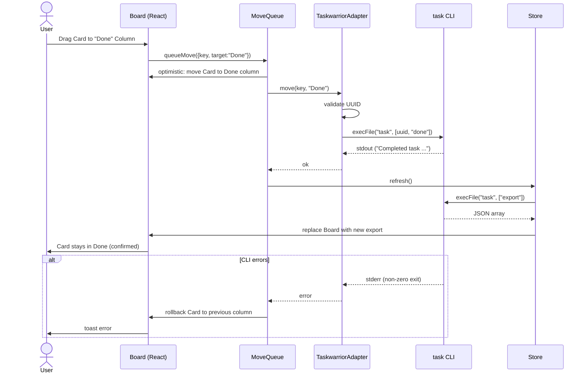
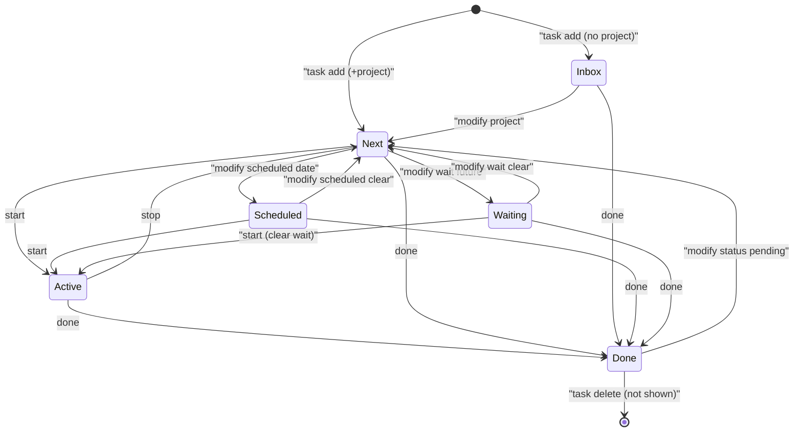

# spec.md — gbj-20261020-035 Taskwarrior-first kanban profile

## Goal
Add a Taskwarrior source to pipe-kan and build a Taskwarrior-first kanban profile: Board, List, Today/Upcoming, and Calendar views on a local Taskwarrior replica, with keyboard-first navigation, quick-add NLP, and the same Linear-grade polish already established for Jira and Plane.

## Scope
- Taskwarrior source adapter (`src/taskwarrior.ts`) that reads from and writes to a local Taskwarrior 3.x replica via strict-argv `task` CLI calls.
- Taskwarrior-first sidebar profile: projects, tags, contexts, Today, Upcoming, Calendar.
- Board column model mapped from Taskwarrior status + start/wait/scheduled fields.
- Quick-add with NLP extraction for project, tags, due date, priority.
- Full keyboard shortcuts (`C`, `E`, `D`, `S`, `Cmd+K`, `J`/`K` nav).
- Playwright smoke on fake Taskwarrior data; hostile-input tests for CLI safety.

## Non-goals
- Do NOT implement TaskChampion sync server in this slice — the app reads a local replica only.
- Do NOT add a native mobile app or PWA.
- Do NOT add time-blocking / drag-to-calendar-slot (timebox already exists at `/timebox`).
- Do NOT add real-time multiplayer / sharing.
- Do NOT add LLM-based NLP parsing.
- Do NOT modify Jira or Plane sources except for the shared switcher chrome.

---

## 1. Taskwarrior field mapping

| Taskwarrior field | pipe-kan concept | Notes |
|---|---|---|
| `uuid` | Issue key | Primary identifier; shown as a short chip |
| `description` | Summary / Card title | |
| `status` (`pending`/`completed`/`deleted`/`waiting`/`recurring`) | Board column membership | See §2 column model |
| `start` | Active / In Progress | A `pending` task with `start` is "Active" |
| `wait` | Waiting | `pending` task with future `wait` is "Waiting" |
| `scheduled` | Scheduled | Display date; can be used for Calendar |
| `due` | Due date | Card due pill + Calendar event |
| `until` | Expiration | Not displayed on card; used for cleanup warnings |
| `project` | Project / Scope | Sidebar project list; hierarchical (`a.b.c`) |
| `tags` | Labels | Sidebar tag list; card label pills |
| `priority` (`H`/`M`/`L` or UDA) | Priority | Card priority pill |
| `urgency` | Sort weight | Not displayed as a field; used for default sort |
| `annotations` | Comments / Notes | Shown in Open detail pane |
| `depends` | Dependencies | Shown in Open pane as "Blocked by" |
| `recurrence` | Recurring parent | Not shown as a Card; child instances are |
| `entry` | Created | Card age |
| `modified` | Updated | Sort / filter |
| `context` (filter definition) | Sidebar context lens | Selecting a context applies its filter |

### UDA support
Common UDAs (`reviewed`, `estimate`, `story_points`, etc.) are passed through as raw fields in the Card payload. The UI does not render them by default; Display options can toggle them on. UDAs are read from `task _udas` at boot and cached.

### Priority model
Taskwarrior native `priority` is `H`/`M`/`L`/`None`. The adapter normalizes:
- `H` → "Urgent" (red dot)
- `M` → "High" (orange dot)
- `L` → "Low" (blue dot)
- unset → "None" (no dot)

This matches the Plane/Jira priority rank already in `parity.ts`.

---

## 2. Configurable column model

Default columns (Taskwarrior profile):

| Column | Taskwarrior rule | Color / indicator |
|---|---|---|
| **Inbox** | `status:pending` and no `project` and no `scheduled` | Gray header |
| **Next** | `status:pending` and `project` set and not `start` and not `wait` | Blue header |
| **Active** | `status:pending` and `start` set | Green header + timer indicator |
| **Waiting** | `status:pending` and `wait` > now | Yellow header + clock icon |
| **Scheduled** | `status:pending` and `scheduled` set and not `start` | Purple header |
| **Done** | `status:completed` | Muted header; collapsed by default |

Column rules are expressed as Taskwarrior filter strings (e.g., `status:pending -wait -start`). They are stored in local chrome state and editable by the user in Display options. The adapter evaluates them client-side after `task export`.

### Column ↔ status write-back
When a Card is dropped on a Column, the adapter maps the Column to Taskwarrior mutations:

| Target column | CLI mutation |
|---|---|
| Inbox → Next | `task <uuid> modify project:<default_project>` (or just clear inbox filter) |
| Any → Active | `task <uuid> start` |
| Active → Next | `task <uuid> stop` |
| Any → Waiting | `task <uuid> modify wait:<now+1d>` (or configurable default wait) |
| Waiting → Next | `task <uuid> modify wait:` (clear wait) |
| Any → Done | `task <uuid> done` |
| Done → Any | `task <uuid> modify status:pending` (undelete) |

Same-Column drop is a no-op. Mutations that would change `status` to `deleted` are rejected.

---

## 3. Write path: strict argv, never shell

All `task` invocations go through a single `execTask(args: string[])` wrapper using `node:child_process` `execFile` (promisified). No shell interpolation. No string concatenation.

```ts
import { execFile } from "node:child_process";
import { promisify } from "node:util";

const execFileAsync = promisify(execFile);

export async function execTask(args: string[], opts?: { timeout?: number }): Promise<string> {
  const { stdout } = await execFileAsync("task", args, {
    timeout: opts?.timeout ?? 30_000,
    maxBuffer: 10 * 1024 * 1024,
    env: { ...process.env, TASKDATA: process.env.TASKDATA },
  });
  return stdout;
}
```

### Hostile-input tests (mandatory)
Every function that builds argv must have tests for:
- Description containing `; rm -rf /`
- Description containing backticks, pipes, `$()`, `"`, `'`, `\`
- UUID containing non-hex characters (rejected before CLI call)
- Project name containing spaces (quoted correctly by argv, not by us)
- Tag containing spaces (split into separate argv entries, or rejected)

The `task` binary receives each value as a single argv element. Because `execFile` passes an array directly to `execve`, no shell metacharacter can execute.

### Validation layer
Before argv construction:
- `uuid` must match `/^[0-9a-fA-F-]{36}$/i` (standard UUID format)
- `project` must match `/^[a-zA-Z0-9_.-]+$/` (alphanumeric, dot, underscore, hyphen)
- `tags` must match `/^[a-zA-Z0-9_-]+$/` each
- `description` is passed raw (no shell risk with argv)

Rejection happens with a user-facing toast, not a silent failure.

### Read path
Boot: `task export` (JSON array) → parse → build Board.  
Refresh: same.  
Incremental updates after a local mutation: re-run `task export` for the affected UUID only, or re-export the whole set if simpler.

---

## 4. Refresh / conflict model

### Refresh
- **Trigger**: manual (header Refresh button or `R` key), or after any write-back.
- **Payload**: `task export status:pending status:completed` (or `task export` for small task counts).
- **Merge strategy**: server-side truth wins. If a task changed on disk between the last export and the current one, the new export replaces the in-memory store. No three-way merge.
- **Conflict UX**: if a Card the user is editing was modified on disk, show a "Task changed on disk" banner with "Reload" and "Keep my changes" (the latter overwrites on next save).

### Optimistic UI
- Drag a Card to a Column: move it in local state immediately, queue the CLI mutation.
- On success: no-op (already there).
- On failure: toast error, rollback the Card to its previous column.
- The existing `MoveQueue` pattern (`src/move-queue.ts`) is reused.

---

## 5. Auth options

Two options for the operator. Recommended default: **Tailnet-only**.

| Option | How | Pros | Cons |
|---|---|---|---|
| **A. Google SSO (oauth2-proxy)** | Same pattern as CT 425: nginx → oauth2-proxy → pipe-kan@127.0.0.1 | Familiar; already wired for pipekan.tail48fe8.ts.net | Extra hop; oauth2-proxy config; allowlist maintenance |
| **B. Tailnet-only** | Tailscale serve directly to the app; no nginx, no oauth2-proxy | Simpler; Tailscale ACLs already gate membership; no Google credential rotation | No per-user allowlist; anyone on the tailnet can reach it |

**Decision**: default to Tailnet-only for the Taskwarrior host because:
1. The host is already Tailscale-only (no public IP).
2. Funnel is on, but Tailscale ACLs can restrict who can access `taskwarrior.tail48fe8.ts.net`.
3. One fewer moving part (no oauth2-proxy/nginx).
4. Google SSO can be added later without data migration.

If the operator chooses Google SSO, the ansible role should follow the exact pattern in `proxmox/pipekan/README.md`.

---

## 6. Taskwarrior profile: sidebar + views

### Sidebar structure (Taskwarrior source)

```
Inbox           ← needs-input badge (tasks with no project and no scheduled)
Today           ← tasks due today or started today
Upcoming        ← tasks due in next 7 days, or scheduled in next 7 days
Projects        ← collapsible list of all projects from `task _projects`
  work
  personal
  health
Tags            ← collapsible list of all tags from `task _tags`
  @urgent
  @home
Contexts        ← list from `task _context`
  work
  home
  weekend
Views           ← Combined, Calendar, Presets
```

### Today / Upcoming
- **Today**: lens on All stories. Filter = `due.before:today+1d or start.any:`.
- **Upcoming**: filter = `due.before:today+8d or scheduled.before:today+8d`.
- Both are ephemeral lenses (like Triage). Leaving clears the lens.

### Calendar
- Reuses existing `board-calendar.tsx` / `Board | Calendar` tabs.
- Events come from `due` and `scheduled` dates of visible tasks.
- Read-only; no drag-to-date. Clicking a task key Opens the detail pane.

### Combined
- Board of all tasks (like All stories) but with no Epic grouping (Taskwarrior has no Epics).

---

## 7. Quick-add NLP

Trigger: `C` key or Column `+` button.

Extracted fields (regex, no LLM):

| Pattern | Maps to | Example |
|---|---|---|
| `+project` or `+project.sub` | `project` | `Buy milk +groceries` |
| `@tag` | `tags` (array) | `Call mom @phone @urgent` |
| `due:...` or `tomorrow` / `next week` / `in 3 days` | `due` | `Review PR tomorrow` |
| `scheduled:...` | `scheduled` | `Meeting scheduled:friday` |
| `wait:...` | `wait` | `Follow up wait:2weeks` |
| `p1` / `H` / `high` | `priority:H` | `Fix bug p1` |
| `p2` / `M` / `medium` | `priority:M` | `Email team p2` |
| `p3` / `L` / `low` | `priority:L` | `Water plants L` |

Unmatched text becomes `description`.

If no date is parsed, the task lands in Inbox (no project) or Next (project set).

---

## 8. Keyboard shortcuts

| Key | Action |
|---|---|
| `C` | Quick-add composer |
| `Cmd+K` / `Ctrl+K` | Command palette (jump to project, tag, context, view) |
| `J` / `K` | Navigate cards down/up |
| `Enter` or `O` | Open selected card |
| `E` | Edit selected card |
| `D` | Done (complete) selected card |
| `S` | Start / Stop active timer on selected card |
| `R` | Refresh from Taskwarrior |
| `Shift+V` | Display options |
| `1`–`5` | Jump to column 1–5 |
| `G` then `I/T/U/P/A/C/V` | Jump to Inbox/Today/Upcoming/Projects/Tags/Contexts/Views |

---

## 9. Source adapter interface

The Taskwarrior adapter implements the same `Cli` interface as Jira (`createJiraCli`) and Plane (`createPlaneCli`).

```ts
type Cli = {
  refresh(): Promise<RawIssue[]>;
  move(key: string, status: string): Promise<void>;
  create(fields: Partial<RawIssue["fields"]>): Promise<string>; // returns new UUID
  edit(key: string, fields: Partial<RawIssue["fields"]>): Promise<void>;
};
```

- `refresh`: `task export` → JSON parse → map to `RawIssue[]`.
- `move`: maps target status string to the CLI mutations in §2.
- `create`: `task add description:... project:... tags:... due:... priority:...` (argv array).
- `edit`: `task <uuid> modify ...` (argv array).

---

## 10. Mermaid diagrams

### Sequence: drag card → Taskwarrior → refresh



### State: task lifecycle ↔ columns



---

## 11. Data paths

Two deployment paths for the operator.

### Path A: Local replica on app host (recommended for single-user)
- The app host (clean LXC) has Taskwarrior 3.x installed.
- `TASKDATA=/var/lib/taskwarrior/.task` (or home dir of app user).
- `task export` runs locally; no network sync needed.
- Backup is the operator's responsibility (e.g., `task export` + `rsync`).

### Path B: TaskChampion sync server + replica
- A separate host (or the same host) runs `taskchampion-sync-server`.
- App host syncs to it: `task sync`.
- Allows multiple replicas (phone, laptop, app host).
- Adds complexity: sync server auth, TLS, conflict resolution.

**Recommendation**: Path A for the first slice. Path B can be added later without app changes (the adapter only cares about `task export`; where the replica comes from is outside the app).

---

## 12. MVP vs later

### MVP (this job)
- [ ] Taskwarrior source adapter (`src/taskwarrior.ts`) with `Cli` interface
- [ ] Board view with default columns (Inbox, Next, Active, Waiting, Scheduled, Done)
- [ ] List view (same columns, vertical list)
- [ ] Today / Upcoming sidebar lenses
- [ ] Calendar view (due + scheduled dates)
- [ ] Quick-add with NLP
- [ ] Keyboard shortcuts (`C`, `E`, `D`, `S`, `Cmd+K`, `J`/`K`, `R`)
- [ ] Open detail pane (annotations, depends, project, tags, priority, dates)
- [ ] Hostile-input tests
- [ ] Playwright smoke on fake data (light/dark, 1440x900 screenshots)
- [ ] Taskwarrior round-trip tests on throwaway `TASKDATA`

### Later
- [ ] Configurable column rules (user-editable filter strings)
- [ ] TaskChampion sync server integration
- [ ] UDA display toggles
- [ ] Context editing (not just selection)
- [ ] Recurring task visualization (parent/child)
- [ ] Search / filter across annotations
- [ ] Mobile-responsive layout
- [ ] Google SSO (if Tailnet-only is chosen now)

---

## 13. File map (new / modified)

| File | Action | Notes |
|---|---|---|
| `src/taskwarrior.ts` | **New** | Source adapter: `createTaskwarriorCli()`, `taskExport()`, `taskAdd()`, `taskModify()`, `taskDone()`, `taskStart()`, `taskStop()` |
| `src/taskwarrior-map.ts` | **New** | Field mapping: TW JSON → `RawIssue`, `RawIssue` → TW argv |
| `src/taskwarrior-nlp.ts` | **New** | Quick-add parser: regex extraction of +project, @tag, due, scheduled, wait, priority |
| `src/taskwarrior-columns.ts` | **New** | Column rule evaluation: TW export → column buckets |
| `src/taskwarrior-validation.ts` | **New** | Input validation: UUID, project, tag regexes |
| `src/components/taskwarrior-sidebar.tsx` | **New** | Sidebar profile: Inbox, Today, Upcoming, Projects, Tags, Contexts |
| `src/components/taskwarrior-card.tsx` | **New** | Card chrome: timer indicator for active tasks, urgency bar |
| `src/components/taskwarrior-open.tsx` | **New** | Open detail pane: annotations list, depends list |
| `src/components/quick-add-composer.tsx` | **New** or extend `issue-composer.tsx` | NLP-aware composer |
| `src/taskwarrior-smoke.ts` | **New** | Throwaway `TASKDATA` setup for smoke tests |
| `src/server.ts` | Modify | Enable `taskwarrior` source switch; load Taskwarrior fixture |
| `src/app-api.ts` | Modify | Report `taskwarrior` as enabled when env/TASKDATA present |
| `src/command.ts` | Modify | Add Taskwarrior-specific jumps (projects, tags, contexts) |
| `src/parity.ts` | Modify | `sourceOptions` already has `taskwarrior` stub; enable it |
| `src/store.ts` | Modify | Accept Taskwarrior-shaped `StoredIssue` in Fake Jira mode (or new store mode) |
| `src/board.ts` | Modify | No changes expected; TW adapter produces `RawIssue` |
| `src/move-queue.ts` | Modify | No changes expected; TW adapter satisfies `MoveQueueDeps` |
| `tests/taskwarrior-adapter.test.ts` | **New** | Unit tests for mapping, validation, NLP, hostile input |
| `tests/taskwarrior-smoke.test.ts` | **New** | Playwright smoke: create/move/complete/annotate round-trip |
| `fixtures/taskwarrior.json` | **New** | Fake Taskwarrior `task export` payload for first paint |
| `docs/adr/0020-taskwarrior-source.md` | **New** | Decision record |
